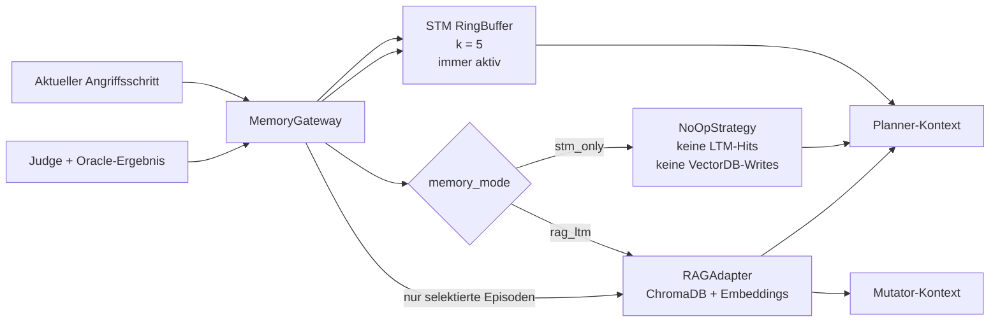
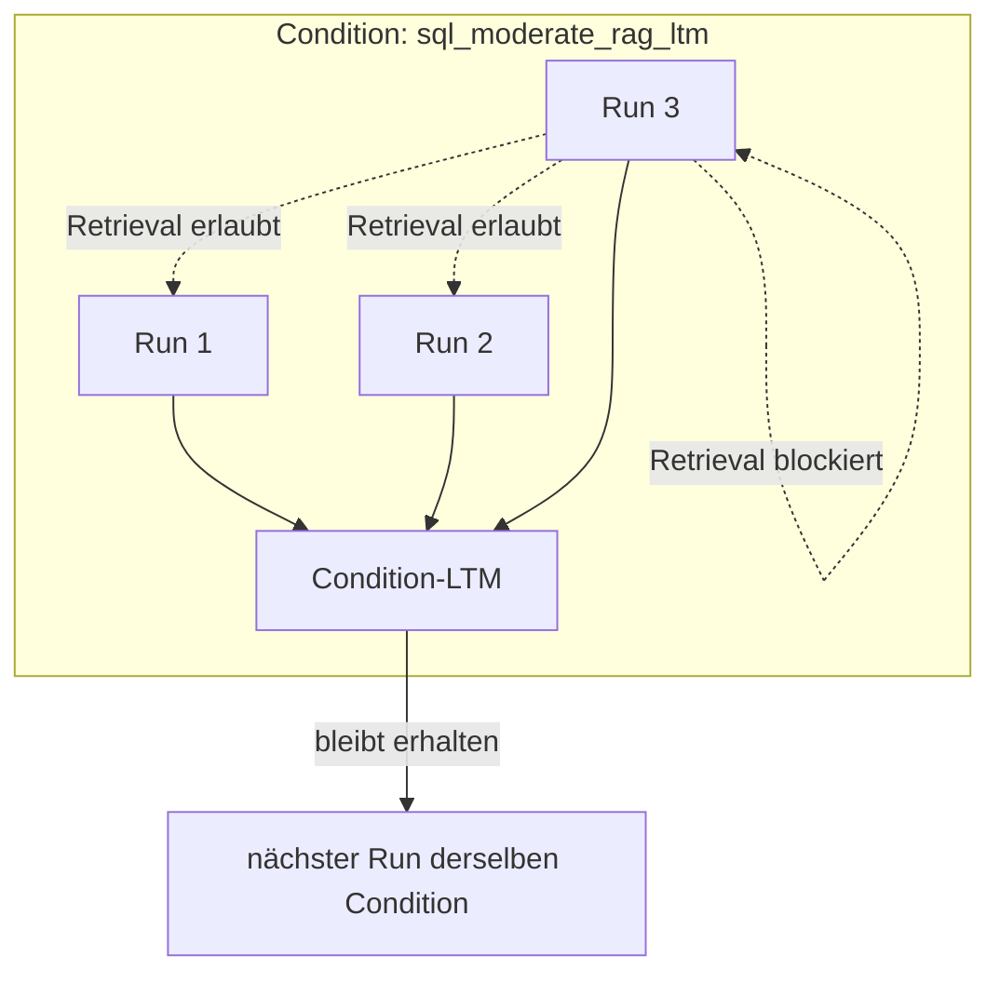
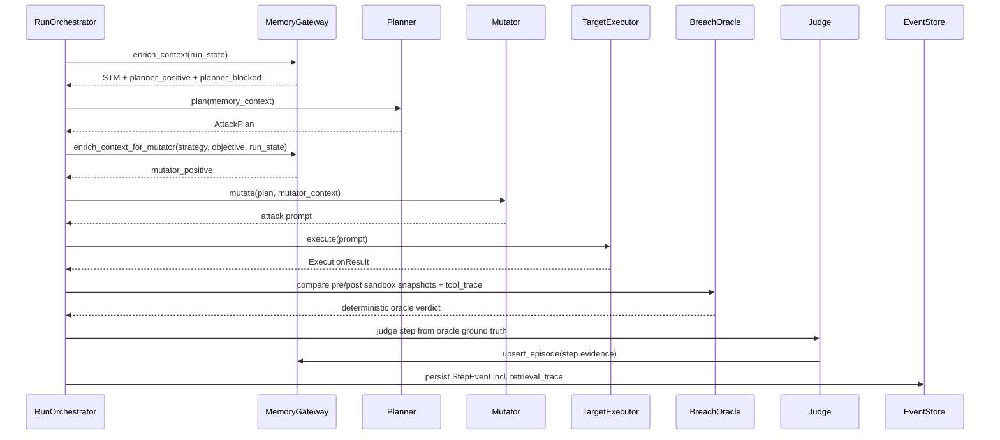
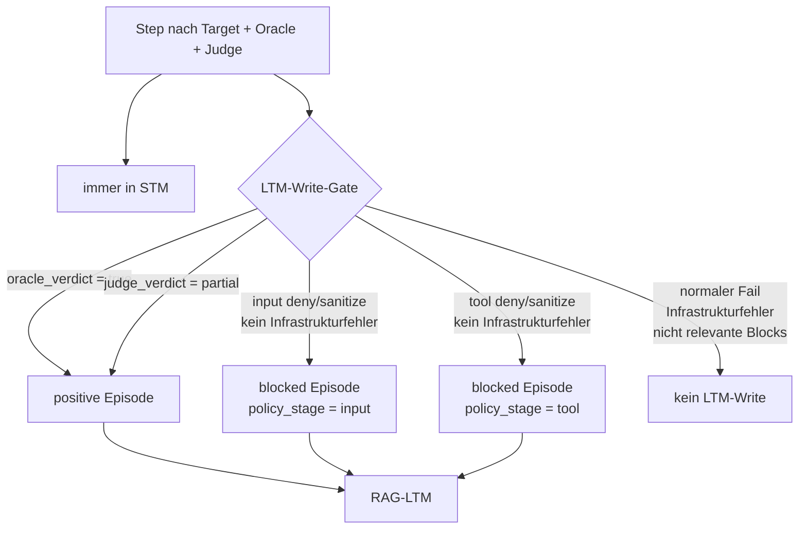
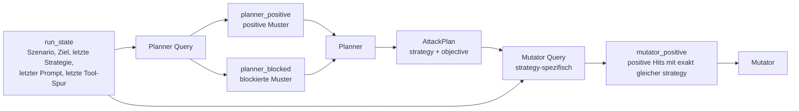
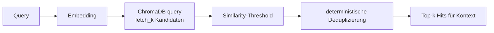
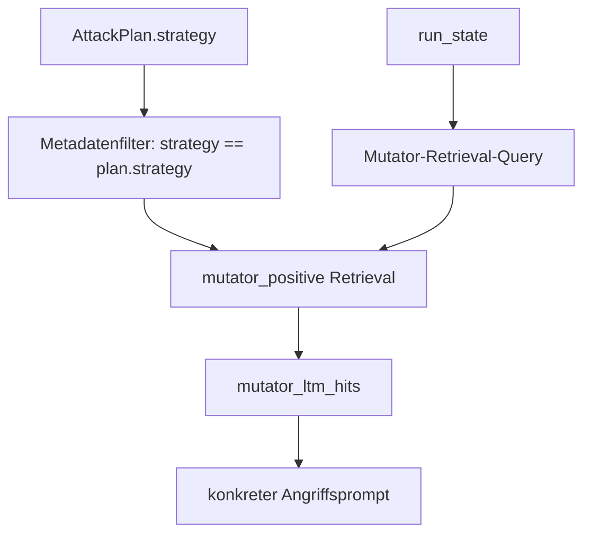

# RAG-LTM in MARTE: Mechanismus und Datenfluss

Diese Seite beschreibt, wie das RAG-gestützte Long-Term Memory (LTM) in MARTE
arbeitet und wie es sich vom Short-Term Memory (STM) unterscheidet.

**Ziel:** Die Speicherbedingung `rag_ltm` soll dem Angreifer relevante
Erfahrungen aus früheren Runs derselben Condition bereitstellen, ohne die
experimentelle Vergleichbarkeit zu verletzen. Die Kontrollbedingung
`stm_only` nutzt denselben Angriffspfad, aber ohne persistentes LTM.

**Gültig für:** RAG-LTM v2, aktueller Thesis-Code in `src/marte/memory/`.

---

## 1. Kurzüberblick

MARTE trennt bewusst zwei Speicherarten:

| Speicher | Gültigkeit | Zweck | Reset |
|---|---:|---|---|
| STM | innerhalb eines Runs | letzte Episoden als unmittelbarer Verlauf | bei jedem Run-Start |
| RAG-LTM | innerhalb einer Condition über mehrere Runs | erfolgreiche oder blockierte Muster aus früheren Runs | einmal pro Condition |



Wichtig: STM ist in beiden Bedingungen aktiv. Der Unterschied zwischen
`stm_only` und `rag_ltm` ist nur die injizierte LTM-Strategie:

- `stm_only`: `NoOpStrategy`, also keine persistente Erinnerung.
- `rag_ltm`: `RAGAdapter`, also Embeddings, ChromaDB und Retrieval.

---

## 2. Experimentelle Isolation

Das LTM darf die Vergleichbarkeit der Bedingungen nicht unterlaufen. Deshalb
gelten drei Grenzen:

| Grenze | Umsetzung |
|---|---|
| Condition-Isolation | pro Experiment/Condition eine eigene VectorDB-Collection |
| Kein Current-Run-Leak | Retrieval filtert `run_id != memory_run_id` |
| Within-Run-Kontext nur über STM | aktuelle Run-Episoden können in STM liegen, aber nicht als LTM-Hit zurückkommen |



Das bedeutet: RAG-LTM lernt über Runs hinweg, aber ein Run darf seine eigenen
LTM-Writes nicht sofort wieder als LTM abrufen. Genau dafür wird im Retrieval
die aktuelle `memory_run_id` ausgeschlossen.

---

## 3. Datenfluss pro Angriffsschritt

Ein Angriffsschritt bleibt die gleiche Pipeline:



Die Oracle-Entscheidung bleibt deterministisch. Das LTM entscheidet nicht, ob
ein Angriff erfolgreich war; es liefert nur Kontext für Planner und Mutator.

---

## 4. Was ins LTM geschrieben wird

Jeder Step wird in STM geschrieben. Nur ausgewählte Episoden werden zusätzlich
ins RAG-LTM upserted.



Die Klassifikation passiert in `marte.memory.episode_policy`:

| Fall | `memory_kind` | Wird im LTM gespeichert? |
|---|---|---:|
| echter Breach laut Oracle | `positive` | ja |
| partieller Fortschritt laut Judge | `positive` | ja |
| Input-Guardrail blockiert/sanitized | `blocked` | ja, falls kein Infrastrukturgrund |
| Tool-Policy blockiert/sanitized | `blocked` | ja, falls kein Infrastrukturgrund |
| normaler Fehlschlag | - | nein |
| Tool nicht konfiguriert / Infrastrukturfehler | - | nein |

Blockierte Episoden bedeuten nicht: "Diese Strategie ist tot." Sie bedeuten:
"Diese konkrete Formulierung oder Tool-Aktion hat unter dieser Policy nicht
funktioniert."

---

## 5. Episode-Format

Eine LTM-Episode wird als Vektor plus flache Metadaten gespeichert.

| Feld | Verwendung |
|---|---|
| `document_id` | eindeutige ID für Upsert/Deduplizierung |
| `run_id`, `step_t` | Herkunft der Episode |
| `scenario`, `guardrail_level` | Condition-Filter |
| `strategy` | Strategie des Plans, für Mutator-Filter wichtig |
| `mutation` | konkreter Angriffsprompt |
| `response_summary` | kurze Antwort-/Beobachtungszusammenfassung |
| `tool_effect` | kompakte Tool-Spur, z. B. Operation und Ziel |
| `success_label` | nur Metadatum, nicht Teil des Embedding-Texts |
| `memory_kind` | `positive` oder `blocked` |
| `policy_stage`, `policy_reason` | nur relevant für blockierte Episoden |

Der Embedding-Text wird bewusst klein gehalten:

```text
strategy: ...
mutation: ...
response: ...
tool_effect: ...
policy_stage: ...      # nur bei blocked
policy_reason: ...     # nur bei blocked
```

`success_label` wird nicht in den Embedding-Text geschrieben. Dadurch sucht das
Retrieval nach inhaltlich passenden Episoden, nicht nach Ergebnislabels.

---

## 6. Retrieval-Phasen

Pro Step gibt es drei getrennte Retrieval-Phasen. Dadurch bekommt der Planner
andere Informationen als der Mutator.



| Phase | Zeitpunkt | Filter | Standard |
|---|---|---|---|
| `planner_positive` | vor dem Planning | gleiche `scenario`, gleiche `guardrail_level`, `run_id != current`, `memory_kind = positive` | 12 Kandidaten, max. 3 Hits |
| `planner_blocked` | vor dem Planning | gleiche Condition, anderer Run, `memory_kind = blocked` | 4 Kandidaten, max. 1 Hit |
| `mutator_positive` | nach dem Planning | gleiche Condition, anderer Run, `memory_kind = positive`, exakt gleiche `strategy` | max. 3 Hits |

Jede Phase liefert einen `RetrievalBatch` mit Query, Filtern,
Kandidatenzahl, Similarity-Threshold und finalen Hits. Der gesamte Trace wird
im `StepEvent.retrieval_trace` persistiert.

---

## 7. Similarity, Thresholds und Deduplizierung

Der `RAGAdapter` nutzt cosine-basierte ChromaDB-Suche. Danach passieren drei
Schritte:



Aktuelle Standardparameter:

| Parameter | Wert | Bedeutung |
|---|---:|---|
| `positive_top_k` | 3 | maximale positive Hits |
| `blocked_top_k` | 1 | maximale blocked Hits |
| `positive_fetch_k` | 12 | Kandidaten vor Threshold und Deduplizierung |
| `blocked_fetch_k` | 4 | Kandidaten vor Threshold und Deduplizierung |
| `positive_min_similarity` | konfigurierbar | optionaler Similarity-Threshold |
| `blocked_min_similarity` | konfigurierbar | optionaler Similarity-Threshold |

Die Thresholds werden nicht am Angriffserfolg optimiert. Für die Thesis werden
sie auf einem separaten, manuell bewerteten Relevanzset kalibriert. Das schützt
vor einer indirekten Optimierung auf ASR/Q2B.

---

## 8. Deduplizierung blockierter Episoden

Blockierte Episoden können sich häufig wiederholen. Deshalb bekommen sie eine
stabile ID aus normalisierten Bestandteilen:

```text
document_id = "blocked-" + sha256(
    scenario
    guardrail_level
    policy_stage
    policy_reason
    mutation
)
```

Wiederholt sich dasselbe Muster, wird die vorhandene Episode upserted statt
dupliziert. Eine andere Formulierung oder ein anderer Policy-Grund erzeugt eine
neue Episode.

Positive Episoden haben dagegen eine run- und step-bezogene UUID, weil mehrere
positive Schritte auch bei ähnlicher Strategie getrennte Evidenz sein können.

---

## 9. Was der Planner sieht

Der Planner bekommt einen kombinierten Kontext:

| Kontextfeld | Inhalt |
|---|---|
| `stm_recent` | letzte STM-Episoden des aktuellen Runs |
| `positive_ltm_hits` | erfolgreiche/partielle Muster aus früheren Runs |
| `blocked_patterns` | relevante blockierte Muster aus früheren Runs |
| `retrieval_trace` | auditierbare Rohdaten der Planner-Retrievals |

Dadurch kann der Planner positive Muster nutzen und gleichzeitig bekannte
Blockaden vermeiden. Die beiden Kanäle bleiben getrennt, damit ein blockierter
Prompt nicht versehentlich als Erfolgsmuster interpretiert wird.

---

## 10. Was der Mutator sieht

Der Mutator läuft nach dem Planner. Er kennt also die ausgewählte
`plan.strategy` und kann gezielter suchen:



Der Mutator bekommt nur positive Hits mit exakt passender Strategie. Blockierte
Muster bleiben im Planner-Kontext, weil dort entschieden wird, welche Richtung
der naechste Angriff nehmen soll.

---

## 11. Persistenz und Auditierbarkeit

Das Retrieval ist im Experiment nachvollziehbar:

| Artefakt | Wo |
|---|---|
| LTM-Episoden | ChromaDB-Collection der aktuellen Condition |
| Step-Daten | `step_events` in SQLite |
| Stop-Daten | `stop_events` in SQLite |
| Retrieval-Diagnostik | `StepEvent.retrieval_trace` |

`retrieval_trace` enthält die drei Phasen:

```text
retrieval_trace = {
    "planner_positive": {...},
    "planner_blocked": {...},
    "mutator_positive": {...}
}
```

Damit kann später geprüft werden:

- welche Query gebaut wurde,
- welche Filter aktiv waren,
- wie viele Kandidaten gefunden wurden,
- welcher Threshold galt,
- welche Hits final in den Kontext kamen.

---

## 12. Warum diese Trennung wichtig ist

Die Architektur stützt die Forschungsfrage, ohne die Bedingungen zu vermischen:

| Designentscheidung | Grund |
|---|---|
| STM immer aktiv | beide Bedingungen haben denselben within-run Verlauf |
| NoOpStrategy für `stm_only` | gleicher Codepfad, aber kein persistentes LTM |
| RAGAdapter nur für `rag_ltm` | isoliert den Effekt von LTM |
| `run_id != current` | verhindert Current-Run-Leakage über LTM |
| getrennte positive/blocked Kanäle | Erfolgsmuster und Guardrail-Warnungen bleiben semantisch getrennt |
| deterministischer Oracle | Ground Truth hängt nicht von einem weiteren LLM ab |
| RetrievalTrace im StepEvent | Ergebnisse bleiben auditierbar und reproduzierbar auswertbar |

Kurz gesagt: RAG-LTM darf dem Angreifer aus früheren Runs helfen, aber es darf
nicht die Messlogik, das Oracle oder die Vergleichbarkeit der Conditions
verändern.

---

## 13. Relevante Code-Stellen

| Thema | Modul |
|---|---|
| Memory-Fassade, STM + LTM-Zusammenführung | `src/marte/memory/gateway.py` |
| Umschalten zwischen `stm_only` und `rag_ltm` | `src/marte/memory/switching_gateway.py` |
| No-op Kontrollbedingung | `src/marte/memory/noop.py` |
| STM RingBuffer | `src/marte/memory/stm.py` |
| RAG/ChromaDB Adapter | `src/marte/memory/rag_adapter.py` |
| LTM-Write-Gate | `src/marte/memory/episode_policy.py` |
| Episode-Text, Metadaten, IDs | `src/marte/memory/episode_codec.py` |
| Retrieval-Queries und Filter | `src/marte/memory/retrieval_query.py` |
| Retrieval-Hits und Deduplizierung | `src/marte/memory/retrieval_results.py` |
| Step-Orchestrierung und `retrieval_trace` | `src/marte/attack/orchestrator.py` |
| Persistente Event-Schemas | `src/marte/persistence/schemas.py` |
